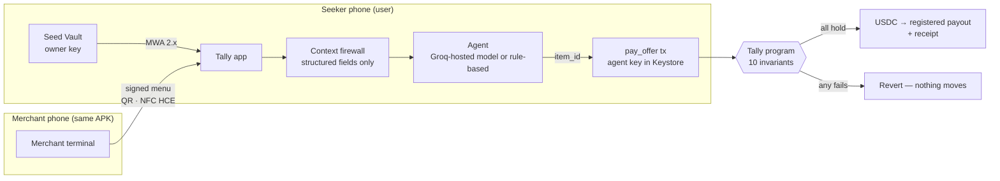

<div align="center">

# Tally

**Your agent proposes. The merchant signs. Tally checks it on-chain.**

An AI agent buys coffee, lunch and transit for you from a Solana Seeker phone, but it can only pay for an item a merchant signed, at the signed price, to the merchant's registered account, inside the rules you signed in Seed Vault. If the agent is talked into anything else, the Solana program reverts the transaction.

*Spending limits protect your balance. Tally protects your decision.*

[](https://github.com/LSUDOKO/Tally/actions/workflows/ci.yml)


Built for **CLOCK IN, the Solana Mobile Hackathon** (Mobile track)

[Whitepaper](docs/00-whitepaper.md) · [Threat model](docs/11-threat-model.md) · [Test suite map](tests/litesvm/THREAT_SUITE.md) · [Demo script](docs/14-demo-script.md) · [Real-phone run](docs/21-real-phone-run.md)

</div>

---

## The problem

AI agents can now pay on our behalf, and today they're protected with spending caps and allowlists. 2026 research shows that the real attack is not stealing a large amount. It's **one sentence of merchant text talking the agent into the wrong item**: a pricier listing (steered **73.3%** of the time in *Signing the Transaction but Not the Decision*, arXiv 2609.11757), an add-on nobody showed, or a different payee. Those carts are well-formed, under the cap and signed by an authorised key, so every perimeter check passes.

Caps answer *how much*. Allowlists answer *to whom*. **Tally answers *which item, at which signed price, from which registered merchant*, and asks you when the agent picks the pricier one.**

## How it works



One atomic Solana transaction binds three proofs:

1. **Merchant proof.** A 144-byte menu header signed by the merchant's registered Ed25519 key, plus a Merkle proof for the chosen item.
2. **Intent proof.** A **capsule** PDA holding your rules (caps, categories, bond tier, expiry), which only your Seed Vault key can change.
3. **Execution proof.** Instructions-sysvar introspection with hardened Ed25519 offsets, then exact balance post-conditions.

### `pay_offer`: the ten invariants

| # | Invariant | Blocks |
|---|---|---|
| 1 | Agent signer, capsule not frozen or expired, merchant active | Stolen or rotated keys, kill switch |
| 2 | The previous instruction is the native Ed25519 precompile (sysvar introspection) | Missing or forged signatures |
| 3 | **Offset hardening**: one signature, every `*_instruction_index == u16::MAX`, offsets ≥ 16, strict bounds, message == rebuilt header | The precompile offset-hijack bug class *(mutation-verified: with the pin removed, the exploit transaction succeeds)* |
| 4 | Fresh slot window ≤150 slots (~60 s); longer windows need your co-sign | Stale QR replay |
| 5 | Payout = the merchant's **registered** account (never from the QR) | Payee swap |
| 6 | The program hashes the leaf itself; Merkle inclusion under the signed root | Price tampering, phantom add-ons |
| 7 | 256-category bitmap, per-purchase cap, rolling ~24 h cap | Out-of-policy spend |
| 8 | **Cheapest-Match:** price > category floor, under-bonded merchant, or extended window → owner co-sign | Whisper upsells (surfaced to you) |
| 9 | Receipt PDA `(capsule, merchant, menu_nonce, item_id)` is `init` | Double charges |
| 10 | `transfer_checked`, then `vault Δ == −price` and `payout Δ == +price`; optional exact Lighthouse assertion | Hidden drains, fee-on-transfer mints, state drift |

Also on-chain: an **SKR merchant bond** (no bond means no autonomy), **trustless fraud-proof slashing** (anyone can slash a merchant whose own signed menu contradicts its certified floor), arbiter disputes, a **Seeker Genesis Token** check for Seeker-only promos, and a merchant-enabled **proof-of-work anti-flood gate**. Details are in [docs/06](docs/06-onchain-program.md).

`pay_offer` costs about **20.4k compute units** (about 22.8k with a 4,096-item menu; target < 45k).

## What's in the repo

| Path | What |
|---|---|
| [`programs/tally`](programs/tally) | Anchor 1.2 program: 24 instructions |
| [`crates/tally-core`](crates/tally-core) | Byte-level primitives shared by the program and tests (header, leaves, Merkle, hardened Ed25519 parsing, post-conditions, PoW) |
| [`tests/litesvm`](tests/litesvm) | Threat-model suite: every on-chain attack in [docs/11](docs/11-threat-model.md) asserts its exact revert ([map](tests/litesvm/THREAT_SUITE.md)) |
| [`fixtures`](fixtures) | Cross-language vectors: Rust, TypeScript and Kotlin must reproduce every byte |
| [`sdk`](sdk) | TypeScript SDK (`@solana/kit` + Codama client), menu signing, `pay_offer` builder, error sentences |
| [`scripts`](scripts) | Deploy, initialise a cluster, seed the demo world, replay the attacks with explorer links, faucet |
| [`app`](app) | Android app (Kotlin + Compose): Seeker user mode **and** merchant terminal in one APK |
| [`docs`](docs) | Whitepaper, specs, threat model, research, demo script, deck outline, plans |

## Tests

| Suite | Count | What it proves |
|---|---|---|
| `cargo test --workspace` | **155** | Core vectors + 119 LiteSVM integration tests against the compiled `.so` (exact error codes, real Token-2022 SGT accounts, real mainnet Lighthouse program) |
| `pnpm -C sdk test` | **15** | TS byte parity with Rust; canonical instruction order; generates `fixtures/tx-v1.json` and the per-instruction `fixtures/ix-v1.json` |
| `./gradlew :core:test` (in `app/`) | **72** | Kotlin byte parity with Rust **and** `@solana/kit` (every instruction the app builds, PDAs, compiled message); context firewall and the exact HTTP body sent to the hosted model; a software NFC tap carrying a real signed menu; Second Look; spend allowance. One opt-in test (`TALLY_LIVE=1`) pays, and is attacked, on devnet through the Kotlin client |

The demo flow was also run end to end against `solana-test-validator`. The honest purchase pays; the payee swap, phantom add-on and stale menu revert with the expected codes; the Whisper upsell stops for co-sign; the owner-approved purchase pays.

## On-chain evidence (devnet)

Every claim above can be checked on the explorer. The first six rows come from the scripted demo ([docs/DEVNET.md](docs/DEVNET.md)), the rest from a stock Android phone with Solflare ([docs/21](docs/21-real-phone-run.md)). Program: [`3ofJ…djqk`](https://explorer.solana.com/address/3ofJTv8xX68aFTQJLNZV2tDXESPuCjcfRHpeLd37djqk?cluster=devnet).

| What happened | What it proves | Result | Transaction |
|---|---|---|---|
| Honest purchase: the agent buys the $4.50 oat latte, the cheapest match | Autonomous payments work: signed menu, cheapest-match rule, payee from the registry. No human tap. | **Paid** | [5X3y…ZwcF](https://explorer.solana.com/tx/5X3yy6tRD3nVwSWK5vFBf3shBMN8hJDksrby8kk1PUyeykkkGZCKY73i16VJta9RfpDA2piYZz7tsFoqYtWZwcF?cluster=devnet) |
| Payee swap: pay an attacker account instead of the café | The money can only go to the merchant's registered payout. | **Reverted 2001** | [4eCo…vPCE](https://explorer.solana.com/tx/4eCo3iQviYdcfnjLxqyETCoWZTCqFskQX3uBieXeEeR9vNfVPVwK2wcQnEQ75As8p7Qw6TkyvmejuAtLN6XBvPCE?cluster=devnet) |
| Phantom add-on: a $2.99 "service fee" the café never signed | Only items in the merchant's signed Merkle root can be paid. | **Reverted 6009** | [4oot…x8NS](https://explorer.solana.com/tx/4oot9a8F18zqqAFXjK6ntL7uKEh8s93LuaMMBqqb5shNwtqbUE8GUdsQpaghyAjH7sosj2wdoRm6yPDwbsxDx8NS?cluster=devnet) |
| Stale menu: replay a QR from 300 slots ago | Menus expire on-chain (≤150 slots), so screenshots can't be replayed. | **Reverted 6007** | [3wmM…JkzH](https://explorer.solana.com/tx/3wmMJMoqVCwAM2kgjktfyZssyCCWhYDTmLzr9o9kjP9EgkTirBhX15gFQVShuKCZCJ9amTtsCbv3rQJcijYHJkzH?cluster=devnet) |
| Whisper upsell: the agent picks the $5.90 large latte on its own | Anything pricier than the cheapest match needs the owner's signature. | **Reverted 6013** | [8PMb…yszd](https://explorer.solana.com/tx/8PMbmycaGYKJr17VPQCEkqyn7qaR7uapAWH6pT5oXEGG45wor122am1M7RR8tEkPiXdATcRdRSkbroHRrXcyszd?cluster=devnet) |
| The owner approves that large latte | With the owner's co-signature the same purchase goes through. | **Paid** | [56gB…mMH7](https://explorer.solana.com/tx/56gBBA1r2CyJZ12f9udR8Mt9NJcrw11M84R2JBCc5qehkKo33VqSL4qRKcRV8g5LDSXpk5s6js6o3AX7C7rrmMH7?cluster=devnet) |
| Real phone, Solflare: create the capsule with rules and $20 | The owner key stays in the wallet; the app only proposes. | **Created** | [3ZjM…4jDY](https://explorer.solana.com/tx/3ZjM6LwXft7CFAy9V7sib1MnhP1VYv9vgevLPZ6vni1piAz6KRPfUhvXAMpA8f5Wk3tNoZUsQA7LcKTnbuAL4jDY?cluster=devnet) |
| Real phone: the Groq agent buys the $4.50 latte | The hosted agent, behind the context firewall, pays without a human. | **Paid** | [5KFt…h2so](https://explorer.solana.com/tx/5KFt148FsKyrc7CL6x6RcZjJzs8nkYNrqHxZt8xUsXo8FBQwia297PB2cH8CbYMpMidocDNjSCGmNyZ2f2p9h2so?cluster=devnet) |
| Real phone: the large latte, approved on Second Look in Solflare | Agent signature + wallet co-signature in one transaction. | **Paid** | [58eP…EGyD](https://explorer.solana.com/tx/58ePPqG3hK7TWYzXYtsoJXn5iSaNYX2tN8R67uzRhs2TA3esUx8Nb1CQPNqoAag7bxhcTwg2fgNWKLtzBbaHEGyD?cluster=devnet) |
| Real phone: capsule created with a Seeker Genesis Token | The program verifies the token's collection on-chain (Seeker-only features). | **Seeker verified** | [5C5p…rBax](https://explorer.solana.com/tx/5C5pkK2Q48DkbNoPLcDBQB1vLNtBMAL1HhbEqpkCR3DAaSf2eHrM838J7Hpixk2pZqxiMfPiaTX962eE67ABrBax?cluster=devnet) |
| Real phone: claim the Seeker launch promo | One claim per token; a second claim is refused (claim record exists). | **Claimed** | [4UxE…Cznf](https://explorer.solana.com/tx/4UxEYZURtLsiXYc2DK4z9k8rc8jdxoRmaxYh7Li1yEh2Y1WJtfqBKPXDV3RKNQeEz9vy2jf1ptGQL2xp4hMpCznf?cluster=devnet) |

## Try it

### On your phone in five minutes (judges)

1. Install **Solflare** (or Phantom) and switch it to **Devnet** (Solflare: Settings → Network → Devnet). A fresh wallet is best.
2. Install `tally-v1.0.0.apk` from [Releases](https://github.com/LSUDOKO/Tally/releases).
3. Get test funds: [open a "Request devnet test funds" issue](https://github.com/LSUDOKO/Tally/issues/new?template=devnet-test-funds.yml) with your wallet address (tick the box for a test Seeker Genesis Token). These tokens are devnet-only and worthless.
4. In Tally: **Connect** (approve in the wallet) → **Create a capsule** (approve) → **Top up agent with 0.05 SOL** (approve).
5. Pay: **Scan or tap to pay** and scan the live counter QR. Ask for "oat latte" (pays on its own) and then "large oat latte" (Second Look asks you to approve in the wallet). Then open **Red team** and watch four attacks revert on-chain.

The counter QR comes from `npx tsx scripts/counter.ts` (a laptop showing the demo café's menu, re-signed every 20 s), or from a second phone in **Merchant mode**. Optional: paste a Groq API key in Settings to use the hosted agent; without one, the built-in rule agent decides.

### Program

```bash
cargo build-sbf --manifest-path programs/tally/Cargo.toml
cargo test --workspace
```

Requires Rust 1.97.1 (pinned) and Solana CLI 4.0.x.

### Local end-to-end (no devnet SOL needed)

```bash
solana-test-validator --reset \
  --bpf-program 3ofJTv8xX68aFTQJLNZV2tDXESPuCjcfRHpeLd37djqk target/deploy/tally.so \
  --bpf-program L2TExMFKdjpN9kozasaurPirfHy9P8sbXoAN1qA3S95 fixtures/programs/lighthouse.so
pnpm install
cd scripts
TALLY_CLUSTER=localnet npx tsx init-devnet.ts   # mints, SGT collection, config
TALLY_CLUSTER=localnet npx tsx seed-demo.ts     # merchant + SKR bond, SGT-verified capsule
TALLY_CLUSTER=localnet npx tsx attack-demo.ts   # honest pay + attacks, with reverts
```

### Devnet

```bash
./scripts/deploy-devnet.sh
cd scripts && npx tsx init-devnet.ts && npx tsx seed-demo.ts && npx tsx export-app-config.ts
npx tsx faucet.ts <your-phone-wallet-address>   # SOL, test USDC, mock SKR for the demo
npx tsx attack-demo.ts                          # writes docs/DEVNET.md
```

### Android

Download the APK from [Releases](https://github.com/LSUDOKO/Tally/releases), or build it yourself:

```bash
cd app && ./gradlew :app:assembleDebug   # app/app/build/outputs/apk/debug/app-debug.apk
```

On a Seeker: **Connect with Seed Vault** → **Create a capsule** ("Coffee, max $6, $15 a day…") → on a second phone open **Merchant mode**, register with an SKR bond and broadcast → **Scan or tap** → "oat latte" → pay. Then open **Red team**.

**One phone or an emulator:** debug builds have a *Demo owner* switch in Settings (a local key in place of Seed Vault; release builds never include it). Fund that address with `npx tsx faucet.ts <address>`, register it in **Merchant mode**, then use **Scan or tap → Pay this phone's merchant menu (demo)**. The phone signs a fresh menu as the merchant and pays it as the customer, so the whole flow runs on real devnet transactions: purchases, the Second Look co-sign, red team, disputes, freeze, rotation, Lighthouse and proof-of-work mode.

**Any Android phone, real wallet:** Tally talks to whatever wallet answers Mobile Wallet Adapter, which is Seed Vault on a Seeker and Solflare or Phantom elsewhere. The full flow (connect, capsule, top-up, merchant registration, autonomous purchase, the co-signed Second Look purchase, red team) has been run on a Moto G34 with Solflare on devnet. Co-signing checks the wallet's capabilities and uses sign-only or sign-and-send, whichever the wallet offers. To try the Seeker-only features without a Seeker, `npx tsx faucet.ts <address> 0 0 0 --sgt` issues a devnet Seeker Genesis Token from our mock collection; close and recreate the capsule (Settings → Close capsule) to get the verified badge and the promo.

**NFC without two NFC phones:** `NfcExchangeTest` runs a software tap, with the reader and the merchant's HCE responder exchanging the exact APDUs the radio would carry; the signed menu arrives byte for byte and still verifies. Each tap reads from a menu snapshot taken at SELECT, so the terminal's 20-second re-sign can't splice two menus, and the reader refuses stalled terminals and menus over 16 KB. QR carries the same signed bytes and works on every phone.

Optional: paste your own Groq API key in **Settings** to use a hosted model (`openai/gpt-oss-120b` on Groq) as the agent. The key stays in app-private storage and is never built into the APK, and the app makes at most 30 model calls a day. Without a key, a deterministic rule-based agent is used. Either way the model only ever sees item ids, categories, prices, floors and dictionary-filtered name tokens, never merchant prose.

## Security, honestly

- **Blocked on-chain:** payee swap, price tampering, phantom add-ons, menu forgery, double charges, stale replay, conversational "pre-authorised" injection, Ed25519 offset hijack, hidden outflows and fee drains, contradictory floors (slashed), settlement floods.
- **Surfaced to you:** Whisper upsells, simulation-diff phishing (the Second Look sheet shows **gross** outflow and disables approval on unexpected instructions), under-bonded merchants.
- **Bounded:** a stolen agent key or an in-policy drain is limited by caps, categories, expiry, freeze and rotation.
- **Out of scope:** physical relay of a fresh QR, a merchant omitting cheaper items, rubber-stamped approvals, a compromised OS or Seed Vault.

The program has **not been audited**. A fresh whole-branch review found no critical issues, and its eight important findings were fixed with regression tests ([list](tests/litesvm/THREAT_SUITE.md#hardening-from-the-phase-1-review)). Before mainnet, the upgrade authority should move to a multisig and `initialize_config` should be restricted to it.

## Research

Tally combines what five 2026 papers found ([docs/03](docs/03-research-foundation.md)):

- Merchant text steers agents (2609.11757).
- Only deterministic checks at the execution boundary hold (APort Vault, 2609.22076: 140 → 0 unpermitted transfers).
- Those checks must be atomic with execution (Proof-Gated Signing, 2610.00354: simulation-only missed 50/50 drift attacks).
- Previews must show gross outflow (2607.28747).
- Freshness should come from a witness, not the device (2608.04957).

## License

MIT © LSUDOKO
